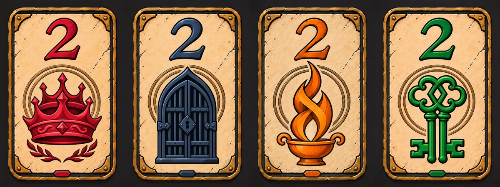

# 이야기 패 승인 디자인 관리

## 2026-11-12 사용자 확정

사용자는 `front-special-v1` 4종을 승인했다. **이야기 패는 프롤로그·일반 대결 패와 형태를 통일하지 않으며, 특별한 문양과 제작 방식으로 차별화한다.** 이후 컷씬에도 이 디자인을 적용한다.

## 기준 원본

아래 PNG는 앞면 디자인의 기준이다. 새 컷씬 생성에는 필요한 패의 PNG를 참조 이미지로 반드시 넣는다. 문장만으로 비슷한 패를 다시 디자인하지 않는다.

| 이야기 패 | 승인 앞면 PNG | 짝을 이루는 뒷면 PNG |
|---|---|---|
| 붉은 왕관 2 | [왕관 앞면](../public/story-cards/crown-two-front-special-v1.png) | [왕관 뒷면](../public/story-cards/crown-two-back-special-v1.png) |
| 검은 철문 2 | [철문 앞면](../public/story-cards/iron-gate-two-front-special-v1.png) | [철문 뒷면](../public/story-cards/iron-gate-two-back-special-v1.png) |
| 성화 2 | [성화 앞면](../public/story-cards/sacred-flame-two-front-special-v1.png) | [성화 뒷면](../public/story-cards/sacred-flame-two-back-special-v1.png) |
| 비밀의 열쇠 2 | [열쇠 앞면](../public/story-cards/secret-key-two-front-special-v1.png) | [열쇠 뒷면](../public/story-cards/secret-key-two-back-special-v1.png) |

앞면은 사용자가 직접 승인한 원본, 뒷면은 이후 컷씬 적용 작업에서 제작한 같은 묶음의 그림이다. 원본 PNG와 앱용 WebP를 함께 보존한다. 철문 앞면 확대 연출에는 배경을 분리한 `iron-gate-two-front-special-cutout-v1`을 사용하며, 디자인 참조 기준은 표의 승인 원본이다.

## 디자인 유지 기준

- 공통: 상아색 판면, 낡은 황동 테두리와 네 모서리 고정 장식, 검은 홈, 이중 고리 각인, 아래 작은 인레이. 굵은 손그림 윤곽·단순한 명암의 2D 카툰 판타지.
- 앞면: 위에 숫자 2 한 개, 아래에 고유 문양. 숫자와 문양은 같은 색 계열이다.
- 왕관: 빨강 `#ce203a`, 겹친 왕관·마름모 장식·작은 월계수.
- 철문: 검남색 `#263547` / 짙은 잉크 `#0b1521`, 닫힌 이중문·봉인 자물쇠.
- 성화: 주황 `#ee8b23`, 엮이는 두 줄기 불꽃·손잡이 달린 그릇.
- 열쇠: 초록 `#007b3e`, 포개진 상단 고리·나란한 줄기·좌우로 향한 이빨.
- 뒷면: 갈색 판면·금색 선 문양·숫자 없음. 겹친 두 왕관 / 두 철문 / 두 겹 불꽃 / 포개진 두 열쇠. 왕관 뒷면의 단순한 두 왕관은 프롤로그 돌기둥의 단서와 일치시킨다.
- 조명에 맞는 색 변화는 허용하지만, 문양·프레임·숫자 배치를 임의로 다시 해석하지 않는다.

## 컷씬 적용 기준

- 이야기 패를 직접 받거나 살피는 장면, 성화·열쇠 발견, 진엔딩 기록, 마지막 패 전달에는 승인 디자인을 사용한다.
- 일반 승부 중 손패·탁자 패는 기존 소박한 디자인으로 유지한다. 깃발·봉랍·문서·돌 제단에 그린 세계의 문장을 이야기 패의 테두리나 보석으로 바꾸지 않는다.
- 패를 넣을 때 기존 인물·손·배경·구도와 패의 위치·물리적 크기·각도를 유지한다. 손가락 뒤에 가려지는 부분도 지킨다.
- 진엔딩 마을 컷은 이야기 패 4종만 특별하게 보이게 하고, 주변 일반 패에 같은 장식을 퍼뜨리지 않는다. 동일한 이야기 패를 불필요하게 복제하지 않는다.
- 원본을 덮어쓰지 않는다. 새 버전·생성 프롬프트·참조·적용 위치·검증 결과를 기록한다. 앱은 WebP만 참조한다.

## 앱 연결과 이력

`lib/rpg-story-card-art.ts`가 도감 앞뒤, 프롤로그·ST3 그림 쌍, ST6/ST9·엔딩 그림 경로의 공통 목록이다. 새 버전은 이 목록에서 바꾸고, 프롤로그 예열·ST3 확대 연출·여정 도감·가로/세로 표시도 확인한다.

- [앞면 디자인 생성 기록](art-generation-story-keepsakes-special-2026-11-12.md)
- [컷씬 적용·이번 검증 기록](local-story-keepsakes-scenes-2026-11-12.md)
- [앞면 최종 프롬프트](../artifacts/story-keepsakes-special-2026-11-12/manifest.json)
- [컷씬 프롬프트·원본·새 경로](../artifacts/story-keepsakes-scenes-2026-11-12/scene-manifest.json)
- [뒷면·철문 투명 앞면 생성 기록](../artifacts/story-keepsakes-scenes-2026-11-12/back-manifest.json)

승인 디자인 관리와 로컬 연결은 빌드·게시 권한이 아니다. 별도 요청이 없으면 로컬 저장만 한다.
